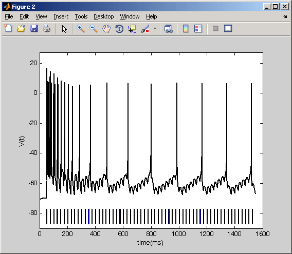

# This is the readme for the matlab code associated with the paper:

Stefanescu RA, Shivakeshavan RG, Khargonekar PP, Talathi SS (2013)  
Computational Modeling of Channelrhodopsin-2 Photocurrent Characteristics in Relation to Neural Signaling. *Bull Math Biol*

All the codes have introductory explanations that could be accessed with the command "help" in Matlab

The folders contain the following codes:

## ChR2

Contains two subfolders: FitChR2_4StateModel and ChR2_3StateModel

### FitChr2_4StateModel

Folder contains all the codes necessary to employ search & optimization algorithms to find the best 4-state parameters to fit the empirical profile; it also provides examples of comparison between the empirical profile and the photocurrent evaluated with the 4-state model (differential equations) for the best parameters we have found for ChRwt and ChETA modeled based on the experimental data provided by Gunaydin et al. 2010

### ChR2_3StateModel

Comprises the code to generate the response to optostimulation of 1s and 2 ms starting from ideal initial conditions (IIC) and special initial conditions (SIC); Nicolic3stateGr_2stimuli.m is investigating the recovery of ChR2 by evaluating the photocurrent in response to two consecutive stimuli of 1s each; the code could be easily modified to generate the recovery curve for ChR2

## WB

The WB folder contains codes used to address the response of an interneuron (with dynamics given by Wang-Buszaki neuron model) expressing ChRwt or ChETA to various optostimulation protocols when either the 3-state or the 4-state model is accounting for ChR2 kinetics

## Gol

The Gol folder contains codes used to address the response of a pyramidal neuron (with dynamics given by Golomb neuron model) expressing ChRwt or ChR ET/TC to various optostimulation protocols when either the 3-state or the 4-state model is accounting for ChR2 kinetics. Typing Golumb_regular4st in the matlab prompt produces an image similar to Fig. 7A in the paper:

## ThSol

The folder ThSol contains the code employed to evaluate the semi-analytical solution for the 4-state model in Light On condition; the Light Off solution provided by Nikolic et al. 2009 is also evaluated

---

2025-07-09: Converted README to Markdown.